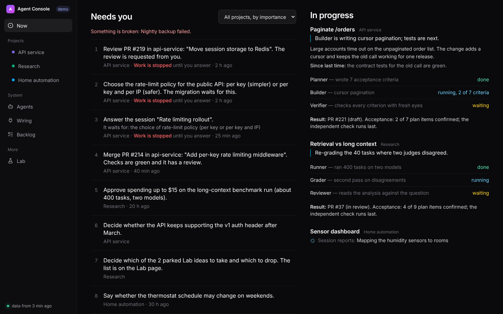
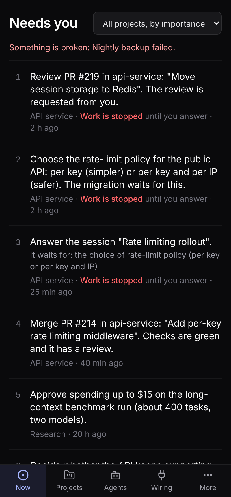
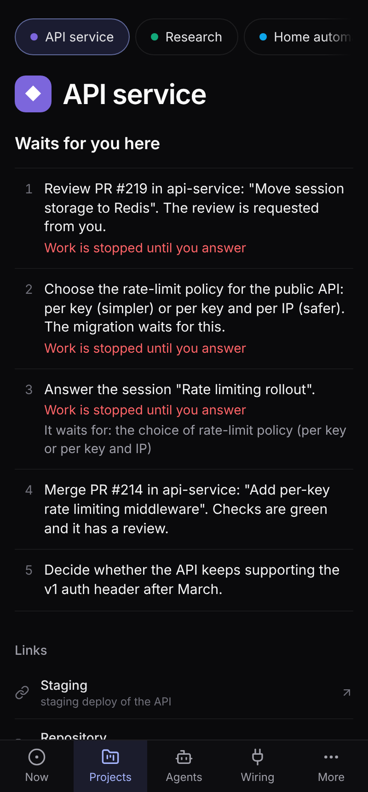
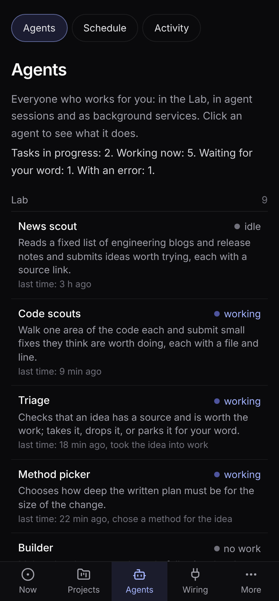
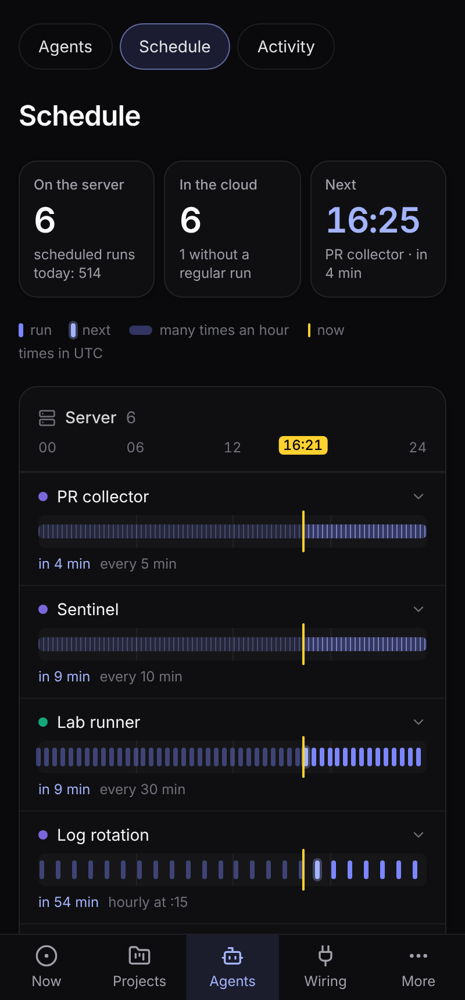
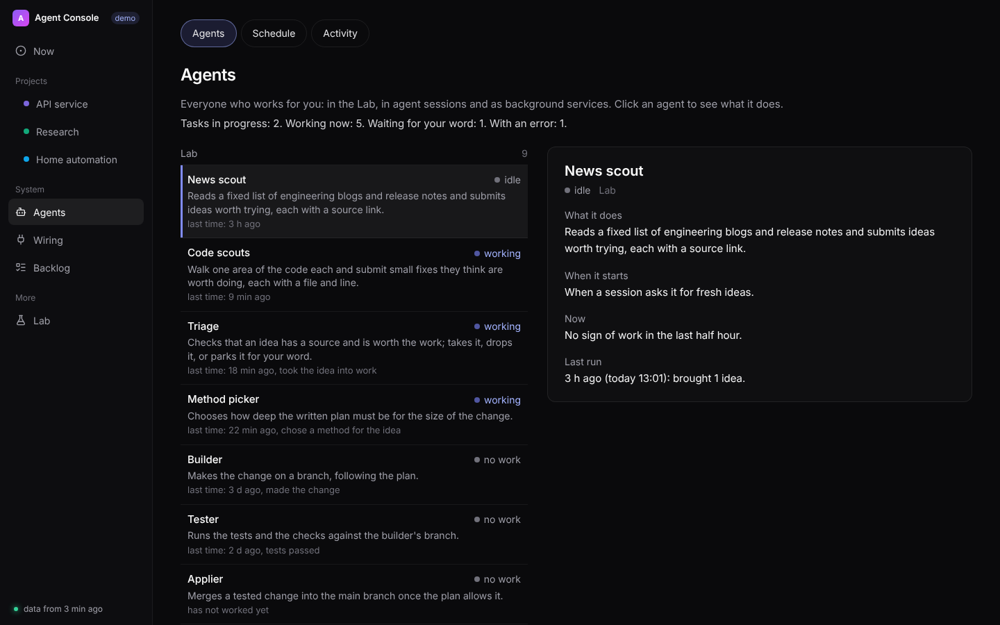
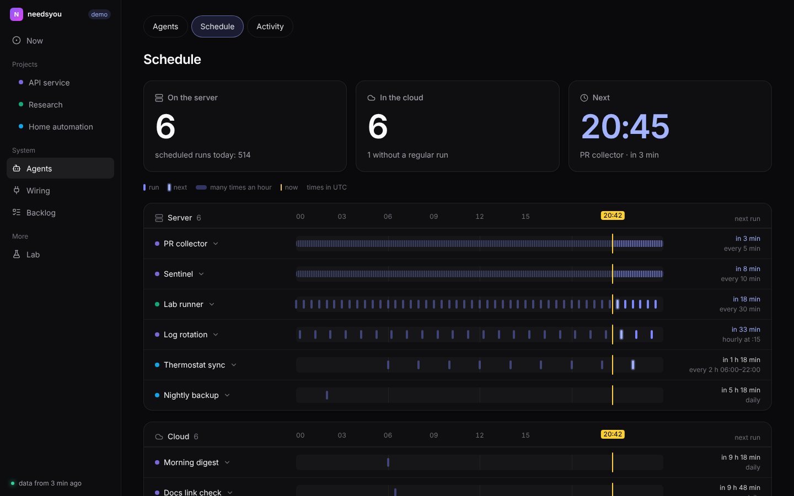

# needsyou

**English** · [Русский](README.ru.md)

[](https://github.com/dmitrykarpushkin/needsyou/actions/workflows/ci.yml)
[](LICENSE)
[](https://dmitrykarpushkin.github.io/needsyou/)

**One page that tells you what your AI agents need from you, ranked by what waiting costs.**

For people who run many coding agents at once (Claude Code sessions, Codex, scheduled jobs) and lose the two questions that block
work somewhere in a dozen chat windows.



**[Open the live demo](https://dmitrykarpushkin.github.io/needsyou/)**: synthetic data, nothing to install.

## Why

- **A to-do list, not a wall of tiles.** Every row is a sentence that says what to do and where: "Merge PR #214 in api-service …
  Checks are green and it has a review." No counters to decode.
- **The most expensive wait comes first.** Work that is stopped until you answer, then cheap merges that unblock others, then
  ordinary requests. Stale sessions and old low-priority requests drop off on their own, so the list does not only grow.
- **All your agents on one page.** Pull requests, waiting sessions, scheduled jobs, service runs, the backlog and the idea queue, from
  every project, instead of one view per tool.
- **It never makes things up.** It shows only what machines recorded (PR state from GitHub, run journal, heartbeats). A missing
  value is shown as unknown, data older than 15 minutes gets a badge, and the service worker caches nothing.
- **Any backend that can write JSON files.** The page only reads files; a cron job and a static folder are enough. The format is
  documented field by field.
- **Works on a phone.** Installable as a PWA, with a phone layout and a bottom bar.

<p>




</p>

## How it compares

The tools below are larger and more mature; needsyou does one narrow thing they do not. You can use it next to them.

| Tool | What it is good at | What needsyou does differently |
|---|---|---|
| Claude Code agent view (`claude agents`, research preview) | Native list of Claude Code sessions; you reply right there | One list across tools and sources (PRs, timers, services, backlog); read-only |
| [Conductor](https://www.conductor.build), [Vibe Kanban](https://github.com/BloopAI/vibe-kanban), [claude-squad](https://github.com/smtg-ai/claude-squad) | Start and isolate agents, review their diffs | Does not run agents; reads what happened anywhere and ranks what needs a person |
| [Langfuse](https://github.com/langfuse/langfuse), [Helicone](https://github.com/Helicone/helicone) | Traces, cost, latency, evals per LLM call | Your next action ("merge PR #214"), not traces |
| [Uptime Kuma](https://github.com/louislam/uptime-kuma), [Homepage](https://github.com/gethomepage/homepage) | Probing, alerts, status pages, many integrations | Agent runs on a schedule axis tied to the same ranked list; no probing, no alerts |

Pick the others when you need to act from the page, run agents, or get alerts: needsyou is read-only, has no login of its own, and
the collectors that feed it are not in this repository.

## Quick start

```sh
git clone https://github.com/dmitrykarpushkin/needsyou && cd needsyou
npm install
npm run dev        # http://localhost:5173 with demo data
```

To use your own data, build with `VITE_DATA_SOURCE=http VITE_DATA_URL=<where your JSON files are>` and serve `dist/` from any
static host. What each file must contain is in [docs/DATA.md](docs/DATA.md).

## How it works

```
your collectors (cron, CI, hooks)  ->  JSON files  ->  needsyou polls them  ->  rank.ts orders "Needs you"  ->  pages
```

The page reads a fixed set of files (`asks.json`, `prs.json`, `agents.json`, `schedules.json`, a run journal and a few more) every
20 seconds to 5 minutes, or listens to an optional Server-Sent Events feed. All ranking rules are pure functions with unit tests. Pages:
Now, Projects, Agents, Schedule, Activity, Wiring (the instructions, skills and hooks your agents run with), Backlog, Lab.

<p>


</p>

More: [design decisions and limitations](docs/design.md) · [data contract](docs/DATA.md) · [development](docs/development.md) ·
other pages: [project](docs/screenshots/project-desktop.png), [activity](docs/screenshots/activity-desktop.png),
[wiring](docs/screenshots/wiring-desktop.png), [backlog](docs/screenshots/backlog-desktop.png), [lab](docs/screenshots/lab-desktop.png).

## Status

A personal project, version 0.1.0. React 19, TypeScript, Vite, Tailwind; 13 unit tests on the ranking, schedule and demo-data logic,
no UI tests. In the original setup it runs on a private server behind a login and is fed by private collectors; here it ships with
synthetic demo data. Not measured: how much time it saves, or whether its ranking matches what someone else finds urgent. Changes are
in [CHANGELOG.md](CHANGELOG.md).

## Where it comes from

Extracted on 2026-10-26 from a private repository where I build a harness for running coding agents under independent checks. In
that repository this page went through 85 commits between 19 and 22 October 2026, 84 of them made by agents working under those
checks (figures from the private history, which is not published because it mentions client work and internal ids). The milestones
with dates are in [CHANGELOG.md](CHANGELOG.md).

Part of a set of three:

- [stopline](https://github.com/dmitrykarpushkin/stopline): git hooks and a Claude Code hook that refuse what an agent claims but did
  not do.
- [foureyes](https://github.com/dmitrykarpushkin/foureyes): the agent that built a change never tests or approves it. Its idea board
  can be served as this page's `lab.json` as is.
- needsyou (this repository): the page where the results of both reach the person.

---

Working in this repository with an AI agent? Its rules are in [AGENTS.md](AGENTS.md).

License: [MIT](LICENSE) · Author: [Dmitry Karpushkin](https://github.com/dmitrykarpushkin)
