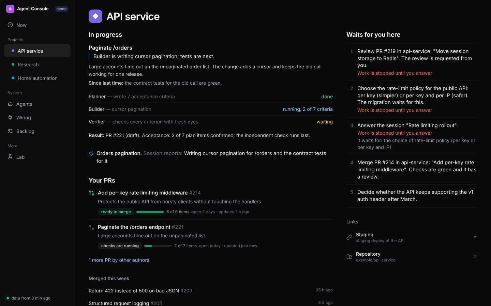
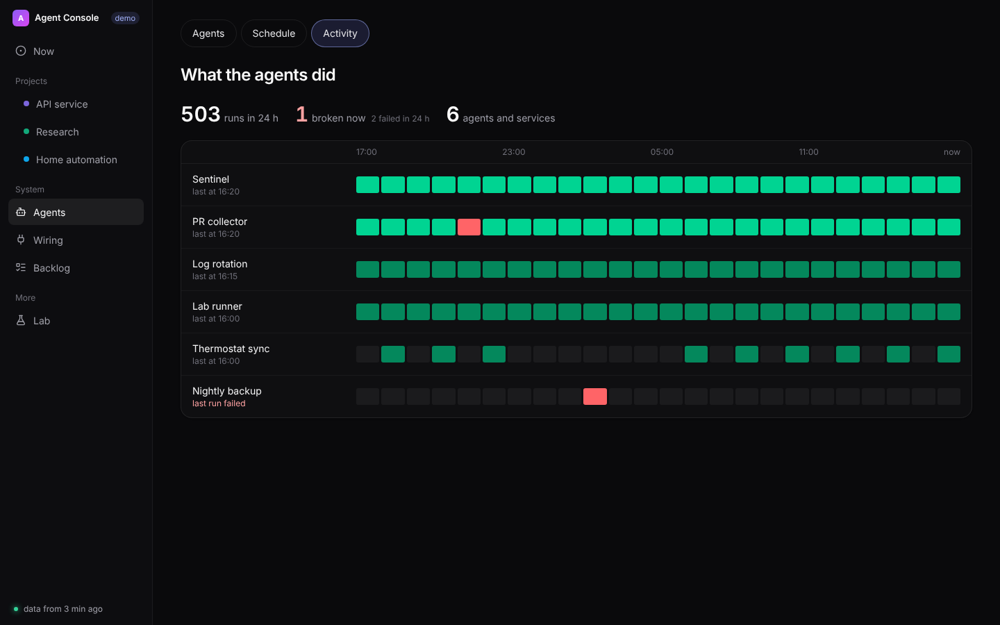
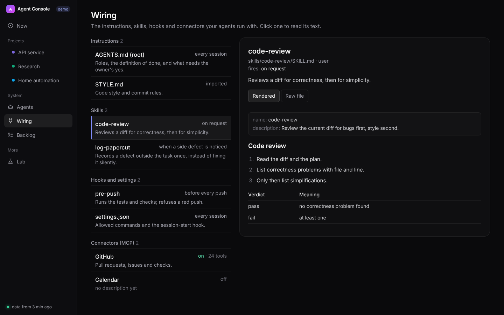
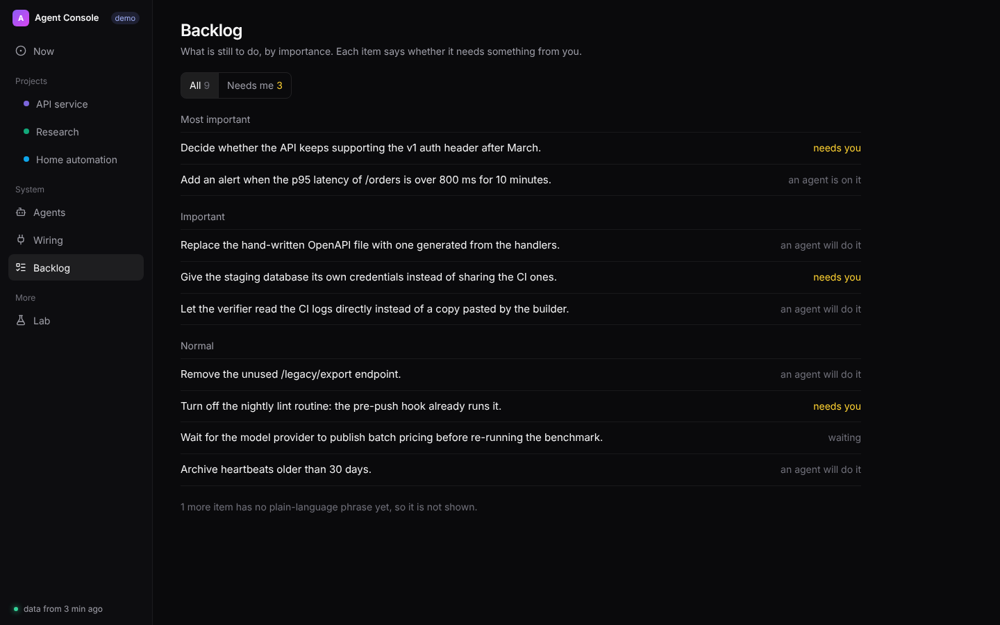
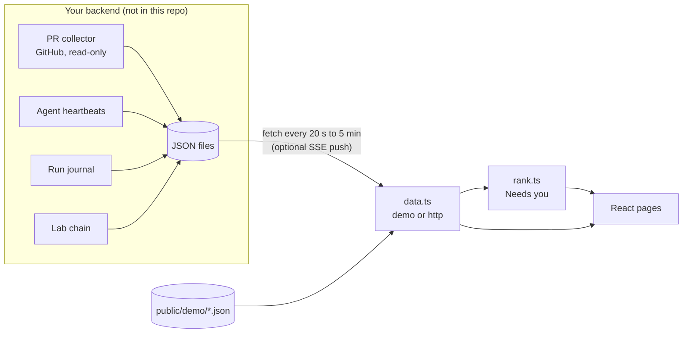

# Agent Console

One screen for a person running many agents: only decisions, results and breakages reach you.

**Live demo:** https://dmitrykarpushkin.github.io/agent-console/ (works after GitHub Pages is enabled for this repository; the
`pages.yml` workflow builds the demo and publishes it).


## Why it exists

If you run a dozen AI coding agents (Claude Code sessions, Codex, scheduled routines, background jobs), the hard part stops being the
work and becomes attention. Each agent reports in its own place, and each report is the agent's own account of itself. "Done, all tests
pass" from an agent is a claim, not a fact. Reading every session to find the two questions that block work does not scale.

Agent Console is the page I keep open instead. It reads facts that machines collected (pull request state from GitHub, run results from
a journal, heartbeats with timestamps, plan items checked by a separate verifier) and turns them into a short ranked list of what needs
me, with the rest one click away. It is a personal research project that is part of a larger setup for orchestrating LLM agents under
independent checks; this repository is the front end of that setup, published with synthetic demo data.

## What it does

- **Needs you.** One ranked list across all projects: requests agents wrote down, PRs that are ready to merge or wait for your review,
  sessions that wait for your answer, top backlog items, Lab ideas parked for your decision. Blocking items first, each one plain sentence;
  stale waiting sessions and old low-priority requests drop off on their own.
- **In progress.** Tasks with the roles working on them (planner, builder, verifier) and how many acceptance items a verifier confirmed.
- **Projects.** Per project: running work, your open PRs with check state and checklist progress, merged this week, what waits for you.
- **Agents.** Everyone who works for you in three groups (Lab roles, agent sessions, background services) with a status word, the last
  run, and a detail pane that says what it does, when it starts and what it did last, using only fields from the data.
- **Schedule.** Every timer and cloud routine on a 24-hour line with the next run; schedules are read from plain phrases like
  `every 2 h 06:00-22:00` or `tue, fri 07:00`.
- **Activity.** Runs per service per hour for the last 24 hours, failures in red, "broken now" agreeing with every other page.
- **Wiring.** The instructions, skills, hooks and MCP connectors the agents run with, with the real file text rendered.
- **Backlog and Lab.** The backlog by importance with who acts on each item; the Lab's ideas: shipped, in work, waiting for you.
- **Stale data is visible.** When the server sends `Last-Modified`, a file older than 15 minutes gets a badge, and the sidebar shows the age of the whole data set, instead of showing old data as current.
- **Installable.** A PWA (manifest plus a service worker that caches nothing), with a phone layout and a bottom bar.

| Projects | Agents |
|---|---|
|  |  |
| **Schedule** | **Activity** |
|  |  |
| **Wiring** | **Backlog** |
|  |  |

Phone (400 px wide):

<p>


</p>

More: [Lab page](docs/screenshots/lab-desktop.png).

## How it works



The page never writes. It polls a fixed set of JSON files (`console.json`, `asks.json`, `prs.json`, `agents.json`, `work.json`,
`backlog.json`, `lab.json`, `services.json`, `schedules.json`, `wiring.json`, `checks.json`, `journal/<day>.jsonl`), so any backend that can
write files works: a cron job into an nginx folder, a bucket, a small API. The full contract with every field is in
[docs/DATA.md](docs/DATA.md).

`src/data.ts` is the only place that fetches. In demo mode it reads `public/demo/` and moves the timestamps so the demo
always looks live: heartbeats, requests and PRs by the exact `now - anchor`, scheduled runs (journal, service runs, routine runs) by
whole days so they stay at the times their schedules name. A test checks that every demo journal run falls on its timer's schedule. `src/rank.ts` holds the ranking rules as pure functions; `src/schedule.ts` reads the
schedule phrases. Both are covered by tests.

## Stack

React 19, TypeScript 7, Vite 8, Tailwind CSS 4, lucide icons. No state library, no router library, no UI kit beyond two small
shadcn-style components. Tests use the Node built-in runner (`node --test`) on the pure modules.

## Quickstart

Tested with Node 22.22. The tests load `.ts` files through Node's built-in type stripping, which is on by default from Node 22.18.

```sh
npm install
npm run dev          # http://localhost:5173, demo data
```

Other commands:

```sh
npm test             # unit tests of ranking, schedule parsing, backlog order, demo time shift, demo data consistency
npm run typecheck    # tsc, no emit
npm run build        # typecheck + production build into dist/
npm run preview      # serve dist/
python3 scripts/gen_demo.py   # regenerate public/demo/ (deterministic)
```

To point it at a real backend, build with `VITE_DATA_SOURCE=http` and `VITE_DATA_URL=<where your JSON files are>`
(see `.env.example`), then serve `dist/` from anywhere; `base` is relative, so a sub-path works.

Test output after a clean `npm install` (`npm test`, Node 22.22). Excerpt: the result lines and the summary are kept, the
per-test duration blocks and the cancelled/skipped/todo counters (all 0) are cut:

```
ok 1 - only phrased rows are shown, in the builder order, the rest counted
ok 2 - without an order, higher value first; level is clamped to 3..5
ok 3 - every journal run matches the schedule of its timer (UTC)
ok 4 - every server timer has runs in the journal
ok 5 - a blocking ask comes first, then merges, then plain asks
ok 6 - in a shared repo only the owner's own ready PRs are his to merge
ok 7 - a review requested from the owner stops work in a blocking project
ok 8 - stale waiting sessions and old low-priority asks are hidden
ok 9 - reads the common schedule phrases
ok 10 - next firing respects weekdays and the time zone
ok 11 - moves ISO timestamps by the offset and keeps the Z form
ok 12 - moves date-only values by whole days, not timestamps twice
ok 13 - leaves other numbers alone
# tests 13
# pass 13
# fail 0
```

Screenshots are made by `scripts/screenshots.mjs` against `npm run preview`; it needs Playwright with Chromium, which is not a
dependency of the project.

## Continuous integration

- `.github/workflows/ci.yml`: `npm ci`, `npm test`, `npm run build` on every push to `main` and every pull request.
- `.github/workflows/pages.yml`: builds the demo and deploys `dist/` to GitHub Pages. Turn it on once under
  Settings → Pages → Source: GitHub Actions. The build uses a relative base path, so it works under `/agent-console/`.

Neither workflow has run yet: they were written for the public repository and have not been executed on GitHub.

## Part of a set

Three public repositories cut out of one personal research project on orchestrating LLM coding agents under independent checks:

- [agent-gate](https://github.com/dmitrykarpushkin/agent-gate): git hooks and a Claude Code hook that refuse what an agent
  claims but did not do (secrets, wrong authors, red tests, editing before a person said go).
- [agent-lab](https://github.com/dmitrykarpushkin/agent-lab): a queue that moves ideas through a chain of agent roles
  (triage, method, builder, tester, validator, retro). Its `lab/board.json` has the shape of this console's `lab.json`: served under
  that name, it fills the Lab page (checked once with that repository's own example board; ideas there have no `phrase`, so the
  machine titles are shown).
- agent-console (this repository): the screen where the results of both reach the person.

## Design decisions

- **Sentences, not tiles.** The home screen has no counters. Each row says what to do and where ("Merge PR #214 in api-service ...
  Checks are green and it has a review."). A number tells you that something is wrong; a sentence tells you what to do about it.
- **Rank by cost of waiting.** Work that is stopped until you answer comes first, then merges (cheap and they unblock others), then
  ordinary requests, then sessions waiting for you, then background. Ties go to the project listed first in `console.json`.
- **Freshness windows.** A waiting session drops off "Needs you" after 4 days without a heartbeat, a low-priority request after 14 days.
  A list that only grows stops being read.
- **Only data, never invention.** The agent detail pane says "whether it still works cannot be seen from here" when the journal has no
  recent run, instead of guessing. A session's progress percentage is labelled as its own estimate.
- **Files, not an API.** The contract is a set of JSON files, so the producer can be anything and the page can be rebuilt without
  touching the data. An optional Server-Sent Events feed pushes changes when a backend wants lower latency.
- **One place to fetch.** Switching between demo and a real backend is one build-time variable; pages do not know where data comes from.

## Limitations

- This is a personal research project, built for one person's setup. It is not a product and has no authentication of its own:
  in the original setup it sits behind a login gate on a private server.
- The backend that produces the JSON files in the original setup (PR collector, heartbeat collector, journal, Lab) is private and not
  part of this repository. Here the page runs on synthetic demo data; `docs/DATA.md` describes what a backend must write.
- The page is read-only by design: answering a request or merging a PR happens in the tool where it lives (GitHub, the agent session).
- Not measured: how much time it saves, or whether the ranking matches what a different person would consider urgent.
- The schedule reader understands a small English phrase set (listed in `docs/DATA.md`); anything else shows as "on event".
- There are unit tests for the pure logic only; the React pages are checked by eye from the screenshots, not by automated UI tests.

## License

MIT, see [LICENSE](LICENSE).
