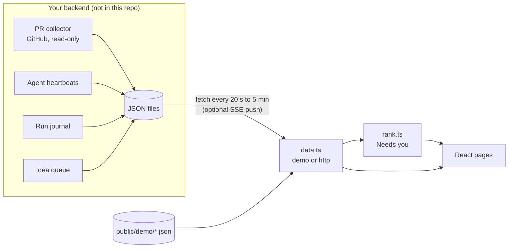

# How needsyou works and why it is built this way

## Data flow

The page never writes. It polls a fixed set of JSON files (`console.json`, `asks.json`, `prs.json`, `agents.json`, `work.json`,
`backlog.json`, `lab.json`, `services.json`, `schedules.json`, `wiring.json`, `checks.json`, `journal/<day>.jsonl`), so any backend that
can write files works: a cron job into an nginx folder, a bucket, a small API. Every field is described in [DATA.md](DATA.md).

`src/data.ts` is the only place that polls (`src/live.ts` holds the optional SSE feed). In demo mode it reads `public/demo/` and moves the timestamps so the demo always looks
live: heartbeats, requests and PRs by the exact `now - anchor`, scheduled runs (journal, service runs, routine runs) by whole days so they
stay at the times their schedules name. A test checks that every demo journal run falls on its timer's schedule. `src/rank.ts` holds the
ranking rules as pure functions; `src/schedule.ts` reads the schedule phrases. Both are covered by tests.

## Pages

- **Now.** One ranked list across all projects: requests agents wrote down, PRs that are ready to merge or wait for your review, sessions
  that wait for your answer, top backlog items, ideas parked for your decision. Next to it, the work in progress with the roles on it
  (planner, builder, verifier) and how many acceptance items a verifier confirmed.
- **Projects.** Per project: running work, your open PRs with check state and checklist progress, merged this week, what waits for you.
- **Agents.** Everyone who works for you in three groups (queue roles, agent sessions, background services) with a status word, the last
  run, and a detail pane that says what it does, when it starts and what it did last, using only fields from the data.
- **Schedule.** Every timer and cloud routine on a 24-hour line with the next run; schedules are read from plain phrases like
  `every 2 h 06:00-22:00` or `tue, fri 07:00`.
- **Activity.** Runs per service per hour for the last 24 hours, failures in red, "broken now" agreeing with every other page.
- **Wiring.** The instructions, skills, hooks and MCP connectors the agents run with, with the real file text rendered.
- **Backlog and Lab.** The backlog by importance with who acts on each item; the idea queue: shipped, in work, waiting for you.

## Design decisions

- **Sentences, not tiles.** The home screen has no counters. Each row says what to do and where ("Merge PR #214 in api-service ...
  Checks are green and it has a review."). A number tells you that something is wrong; a sentence tells you what to do about it.
- **Rank by cost of waiting.** Work that is stopped until you answer comes first, then merges (cheap, and they unblock others), then
  ordinary requests, then sessions waiting for you, then background. Ties go to the project listed first in `console.json`.
- **Freshness windows.** A waiting session drops off "Needs you" after 4 days without a heartbeat, a low-priority request after 14 days.
  A list that only grows stops being read.
- **Only data, never invention.** The agent detail pane says "whether it still works cannot be seen from here" when the journal has no
  recent run, instead of guessing. A session's progress percentage is labelled as its own estimate.
- **Stale data is visible.** When the server sends `Last-Modified`, a file older than 15 minutes gets a badge, and the sidebar shows the
  age of the whole data set.
- **Files, not an API.** The contract is a set of JSON files, so the producer can be anything and the page can be rebuilt without
  touching the data. An optional Server-Sent Events feed pushes changes when a backend wants lower latency.
- **One place to fetch.** Switching between demo and a real backend is one build-time variable; pages do not know where data comes from.
- **Installable, but no offline copy.** A PWA (manifest plus a service worker that caches nothing), so an old screen is never shown as
  the current one.

## Stack

React 19, TypeScript 7, Vite 8, Tailwind CSS 4, lucide icons. No state library, no router library, no UI kit beyond two small
shadcn-style components. Tests use the Node built-in runner (`node --test`) on the pure modules.

## Limitations

- Built for one person's setup. It has no authentication of its own: in the original setup it sits behind a login gate on a private
  server.
- The backend that produces the JSON files in the original setup (PR collector, heartbeat collector, journal, idea queue) is private and
  not part of this repository. Here the page runs on synthetic demo data; [DATA.md](DATA.md) describes what a backend must write.
- Read-only by design: answering a request or merging a PR happens in the tool where it lives (GitHub, the agent session).
- Not measured: how much time it saves, or whether the ranking matches what a different person would consider urgent.
- The schedule reader understands a small English phrase set (listed in [DATA.md](DATA.md)); anything else shows as "on event".
- Unit tests cover the pure logic only; the React pages are checked by eye from the screenshots, not by automated UI tests.
